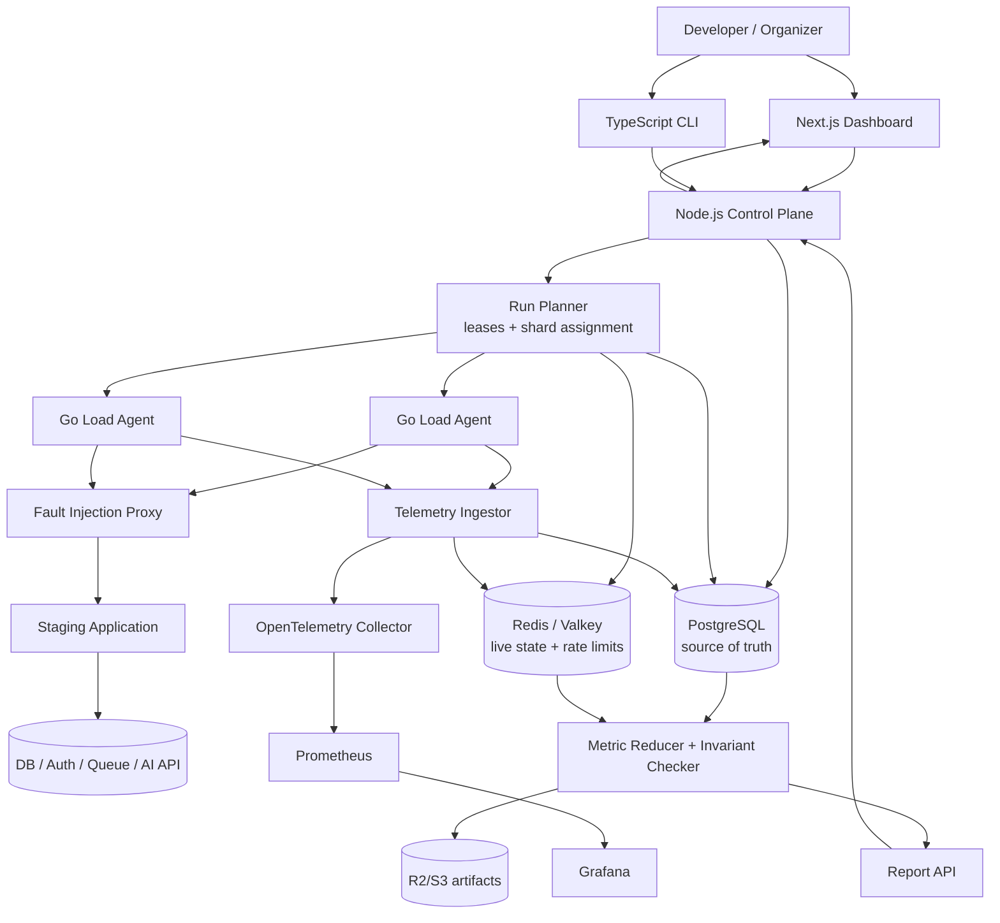

# BurstForge

## A 10-Week Project Decision for Varad Joshi

> **Decision:** Build BurstForge — a self-hosted resilience-testing platform for bursty, mobile-first, and AI-backed web applications.

**Prepared for:** Varad Joshi  
**Date:** 3 November 2026  
**Target:** Working, deployed v1 with real users in 10 weeks  
**Working assumption:** 12–15 hours per week, solo or with one teammate  
**Primary objective:** Build something people use while demonstrating serious distributed-systems design

---

## Contents

1. [Executive decision](#1-executive-decision)
2. [Step 1 — Research current pain](#2-step-1--research-current-pain)
3. [Step 2 — Candidate generation](#3-step-2--candidate-generation)
4. [Step 3 — Hard filtering](#4-step-3--hard-filtering)
5. [Step 4 — Red-team of the top three](#5-step-4--red-team-of-the-top-three)
6. [Step 5 — Final decision](#6-step-5--final-decision)
7. [The project](#7-the-project)
8. [Target users and distribution](#8-target-users-and-distribution)
9. [The honest wedge](#9-the-honest-wedge)
10. [System architecture](#10-system-architecture)
11. [Failure modes](#11-failure-modes)
12. [10-week build plan](#12-10-week-build-plan)
13. [Benchmark and chaos-testing plan](#13-benchmark-and-chaos-testing-plan)
14. [Technology stack](#14-technology-stack)
15. [Risks and kill criteria](#15-risks-and-kill-criteria)
16. [Resume bullets](#16-resume-bullets)
17. [Launch plan](#17-launch-plan)

---

# 1. Executive decision

## Build BurstForge

**One-sentence concept:** BurstForge lets a developer record a critical workflow, replay synchronized traffic against a staging system, inject dependency failures, and prove whether the system survives without duplicate operations, lost jobs, retry storms, or queue collapse.

### Why this project

The repeated production failure pattern is not a lack of endpoint load testing. It is the interaction between:

- synchronized bursts;
- authentication refreshes;
- database locks;
- downstream 429s and timeouts;
- automatic retry loops;
- worker crashes after dequeue;
- patchy mobile connectivity; and
- duplicate form submissions.

Recent incidents from Codeforces, IWAG, GitHub, Convex, Trigger.dev, and the Indian UPI ecosystem show that teams can have individually healthy components while the complete workflow fails under bursty conditions.

BurstForge is the best fit because it combines:

1. **Real pain with fresh evidence.**
2. **A reachable first-user base.** You already have GDG CRCE, Bit N Build, 28 universities, and hackathon operators.
3. **Serious system design.** Leases, fencing, backpressure, multi-tenancy, scheduling, telemetry, invariants, and failure recovery.
4. **Low infrastructure cost.** The core system needs CPU agents, not GPUs.
5. **Strong benchmarks.** You can publish request throughput, p99 latency, retry amplification, recovery time, telemetry loss, and invariant violations.

### What this is not

BurstForge is not another generic load-testing dashboard. Its narrow product promise is:

> **Launch-readiness testing for bursty workflows, with business invariants and controlled dependency failures.**

### The key constraint

The project only survives if real users run it. By week 3, at least five external teams must agree to test a real staging workflow. If they do not, keep the core as an open-source CLI and stop pursuing a hosted SaaS product.

---

---

# 2. Step 1 — Research current pain

Research covered recent engineering postmortems, GitHub issues, Hacker News, Reddit discussions, Indian infrastructure reporting, and current AI-platform job postings. The strongest recurring pattern is:

> **Teams can generate traffic, but they cannot reliably test the interaction between synchronized bursts, retries, queues, authentication, databases, and degraded dependencies.**

## 2.1 Evidence table

| # | Current problem | Evidence |
|---:|---|---|
| 1 | vLLM can accept an unbounded waiting queue until CPU memory is exhausted. | [vLLM RFC #18826](https://github.com/vllm-project/vllm/issues/18826) |
| 2 | Concurrent inference workloads hit GPU out-of-memory failures, KV-cache pressure, and preemption. | [vLLM issue #15942](https://github.com/vllm-project/vllm/issues/15942) |
| 3 | First-come-first-served inference scheduling creates head-of-line blocking for long prompts. | [vLLM scheduling RFC](https://github.com/vllm-project/vllm/issues/16969) |
| 4 | Live LLM calls inside CI randomly fail with 503, 504, and 429 errors, making the CI gate unreliable. | [GitHub issue #332](https://github.com/augustineuzokwe/rtia/issues/332) |
| 5 | LLM evaluations are noisy, slow, difficult to trace, and hard to compare over time. | [PostHog Evals 2.0](https://github.com/PostHog/posthog/pull/31686) |
| 6 | Evaluation frameworks can hang indefinitely for some model providers. | [DeepEval issue #2232](https://github.com/confident-ai/deepeval/issues/2232) |
| 7 | Engineers describe production LLM evaluation as scripts, dashboards, and spreadsheets that miss edge cases. | [Ask HN](https://news.ycombinator.com/item?id=44194187) |
| 8 | LLM-written refactors can introduce subtle infinite loops that pass review and cause outages. | [Sketch outage postmortem](https://sketch.dev/blog/our-first-outage-from-llm-written-code) |
| 9 | Job runners can crash after dequeueing, leaving Redis and Postgres disagreeing about job state. | [Trigger.dev incident](https://trigger.dev/blog/incident-report-sep-26-2025) |
| 10 | A Kafka outage stalled thousands of workflows because a non-critical side effect ran before core business logic. | [Mews Kafka outage](https://developers.mews.com/lessons-from-kafka-outage/) |
| 11 | A burst exposed a Redis connection leak and starved unrelated workloads. | [Transloadit postmortem](https://transloadit.com/blog/2025/09/us-east-redis-connection-exhaustion-post-mortem/) |
| 12 | Retry queues overwhelmed GitHub’s load balancers during a search incident. | [GitHub August 2025 availability report](https://github.blog/news-insights/company-news/github-availability-report-august-2025/) |
| 13 | A reactive backend went from roughly 50 QPS to 20,000+ QPS because invalidation and reconnect behavior amplified load. | [Convex/T3 Chat postmortem](https://news.convex.dev/how-convex-took-down-t3-chat-june-1-2025-postmortem/) |
| 14 | An event-registration launch suffered database locking, SSO overload, automatic retry loops, and cascading failure. | [IWAG registration postmortem](https://iwag.furries.id/en/updates/2025-01-06-crash-postmortem/) |
| 15 | Codeforces’ database could not handle an 88% year-over-year submission increase during a contest burst. | [Codeforces Hacker Cup postmortem](https://codeforces.com/blog/entry/147893) |
| 16 | UPI outages were worsened by repeated transaction-status API calls and missing system-level rate limiting. | [NPCI API guidance](https://www.business-standard.com/finance/news/npci-directs-upi-members-to-follow-new-api-guidelines-to-avoid-disruptions-125042801443_1.html) |
| 17 | Indian-language systems face poor data coverage, mixed-language input, low-end devices, and unreliable connectivity. | [Nature India](https://www.nature.com/articles/d44151-025-00084-4), [BBC](https://www.bbc.com/news/articles/cn0qqzz1e4zo) |
| 18 | CDC pipelines still struggle with duplicates, backpressure, schema changes, snapshots, and WAL growth. | [Postgres CDC lessons](https://risingwave.com/blog/postgres-cdc-iceberg-production-lessons/) |

## 2.2 Additional market signals

Reddit discussions reinforce concerns around model routing, queues, 429s, cost, and inference concurrency. These are directional signals rather than hard market-size evidence:

- [Production LLM deployment lessons](https://www.reddit.com/r/LLMDevs/comments/1nj80hp/production_llm_deployment_lessons_cost/)
- [Reliable AI features under repeated 429s](https://www.reddit.com/r/Backend/comments/1mk0wyd/building_reliable_ai_features_when_llm_apis/)

Current hiring signals point toward the same operational need. Fluid AI, Sarvam, and Starburst are hiring for observability, quotas, scheduling, model gateways, workflow reliability, and developer tooling:

- [Fluid AI — AI Platform Engineer, Observability](https://fluid.ai/careers/ai-platform-engineer-observability)
- [Sarvam — Platform Engineer, AI Infrastructure](https://jobs.ashbyhq.com/sarvam/fcb15601-6440-41f7-aa79-b9992057a4b2)
- [Starburst — AI Platform Engineer](https://job-boards.greenhouse.io/starburst/jobs/5416975008)

## 2.3 What the evidence says

The evidence does **not** prove that people are already searching for “BurstForge.” It proves a more useful thing: the underlying failure class is current, expensive, and recurring.

The product hypothesis to validate is whether small teams want a simpler way to reproduce and explain these failures before launch.

---

---

# 3. Step 2 — Candidate generation

| Candidate | Problem | Who feels it | Why it has not been solved well |
|---|---|---|---|
| **BurstForge** | Test synchronized bursts, retries, degraded networks, and dependency failures against a real workflow. | Hackathon platforms, student startups, small SaaS teams, AI products. | k6 and Locust test traffic, while chaos tools inject faults; few tools combine traffic, business invariants, and failure reports. |
| **AgentReplay** | Record and replay agent executions with deterministic faults and trace comparison. | Teams shipping LangGraph, CrewAI, RAG, or tool-using agents. | LLM nondeterminism, secrets in traces, provider differences, and integration complexity make replay difficult. |
| **Batchline** | Put bounded queues, fairness, admission control, and dynamic batching in front of small inference deployments. | Teams running vLLM, Ollama, Triton, or rented GPUs. | vLLM, Ray Serve, Triton, Modal, RunPod, and hosted gateways already cover much of the market. |
| **MelaMesh** | Offline-first registration, QR check-in, and reconciliation for unreliable event connectivity. | Indian college events, hackathons, conferences, and field events. | Event platforms are commoditized; the wedge depends on proving materially better offline behavior. |
| **OutboxPilot** | A Postgres-native durable integration relay with retries, deduplication, leases, and replay. | Small SaaS teams integrating email, webhooks, search, and analytics. | Existing queues, outbox libraries, and managed workflow tools are abundant. |
| **BharatBench** | Test web and AI products across Indian languages, low-end devices, packet loss, and slow networks. | Fintech, edtech, healthcare, and public-sector developers. | Device farms, localization vendors, and generic browser testing already solve pieces of it. |
| **QueueSentry** | Detect and repair queue/database state divergence, stuck leases, retry storms, and unfair scheduling. | Teams operating Redis/Postgres job systems. | Strong technical value, but it is mostly an operational tool rather than a product users seek proactively. |
| **EvalRail** | Cheap two-tier LLM evaluation with trace drill-down, cost budgets, and nightly live-model tests. | Small teams deploying AI features. | Langfuse, Braintrust, Promptfoo, DeepEval, and LangSmith already occupy this space. |
| **Vernacular Edge** | Offline multilingual AI workflows for field workers and students. | Rural education, health, agriculture, and community organizations. | Requires data, domain partnerships, model quality, and device support that exceed the time window. |

---

---

# 4. Step 3 — Hard filtering

Each candidate is scored from 1 to 5 on seven dimensions. The threshold is **28/35**. Anything below it is dropped.

## 4.1 Scorecard

### BurstForge — **32/35**

- **Demand — 5:** Multiple recent outages show burst, retry, queue, and dependency failures.
- **Reach — 5:** You already have GDG, Bit N Build, 28 universities, and hackathon operators.
- **System depth — 5:** Distributed agents, leases, scheduling, backpressure, telemetry, chaos, invariants, and tenancy.
- **Feasibility — 4:** A focused API-first v1 is achievable; browser-scale realism is not.
- **Measurability — 5:** RPS, p99, scheduling skew, retry amplification, telemetry loss, and recovery time.
- **Resume signal — 5:** Clear platform, reliability, and distributed-systems story.
- **Defensibility — 3:** Generic load testing is crowded; the workflow-specific wedge is defensible only if kept narrow.

### AgentReplay — **30/35**

- **Demand — 5:** Production AI teams complain about eval flakiness, traceability, and nondeterminism.
- **Reach — 4:** Many AI builders are in your network, but fewer have recurring production agent traffic.
- **System depth — 5:** Event sourcing, replay, trace storage, provider variance, redaction, and fault injection.
- **Feasibility — 3:** Deterministic replay of nondeterministic systems is a difficult product problem.
- **Measurability — 5:** Replay fidelity, regression detection, latency, cost, and fault recovery.
- **Resume signal — 5:** Strong AI-infrastructure and systems signal.
- **Defensibility — 3:** Existing observability and evaluation platforms are well-funded and established.

### Batchline — **29/35**

- **Demand — 5:** vLLM issues directly document unbounded queues, OOMs, and scheduling problems.
- **Reach — 4:** AI teams are reachable, but GPU operators are a smaller audience.
- **System depth — 5:** Admission control, queue fairness, batching, quotas, routing, and latency SLOs.
- **Feasibility — 3:** Benchmarking requires GPU access and inference expertise.
- **Measurability — 5:** TTFT, TPOT, throughput, queue time, GPU utilization, and cost/request.
- **Resume signal — 5:** Excellent ML-systems signal.
- **Defensibility — 2:** Existing inference platforms are direct competitors.

### MelaMesh — **29/35**

- **Demand — 4:** Connectivity and event-registration failures are well documented.
- **Reach — 5:** Your distribution is unusually strong.
- **System depth — 5:** Offline sync, conflict resolution, QR identity, reconciliation, burst traffic, and privacy.
- **Feasibility — 4:** A focused check-in flow is practical.
- **Measurability — 4:** Sync latency, conflict rate, check-in throughput, and offline completion.
- **Resume signal — 4:** Strong distributed-systems signal, weaker AI/platform signal.
- **Defensibility — 3:** India-specific offline behavior is a credible wedge.

### OutboxPilot — **29/35**

- **Demand — 5:** Duplicate, lost, and stuck integration events are repeatedly documented.
- **Reach — 4:** You can reach small SaaS builders through developer communities.
- **System depth — 4:** Durable queues, idempotency, retries, replay, ordering, and backpressure.
- **Feasibility — 5:** Very achievable with Postgres and one VPS.
- **Measurability — 5:** Delivery latency, throughput, duplicate rate, recovery time, and backlog.
- **Resume signal — 4:** Strong backend signal but less differentiated.
- **Defensibility — 2:** Outbox, Inngest, Trigger.dev, Temporal, and managed queues are established.

### BharatBench — **28/35**

- **Demand — 5:** Language, device, and network limitations are significant in India.
- **Reach — 3:** Enterprise fintech and public-sector buyers are difficult to access quickly.
- **System depth — 4:** Device/network simulation, workload orchestration, localization assertions, and reports.
- **Feasibility — 3:** Device coverage and language quality are hard to build credibly.
- **Measurability — 5:** Completion rate, latency, crash rate, language accuracy, and network sensitivity.
- **Resume signal — 5:** Strong India, reliability, and AI story.
- **Defensibility — 3:** The India-specific test corpus could become a wedge.

## 4.2 Dropped candidates

- **QueueSentry — 27/35:** Technically interesting, but monitoring-only tools are difficult to distribute.
- **EvalRail — 27/35:** Real pain, but the research shows a crowded and noisy market.
- **Vernacular Edge — 22/35:** Meaningful problem, but model, data, and domain requirements make it too broad for 10 weeks.

---

---

# 5. Step 4 — Red-team of the top three

## 5.1 BurstForge

### Strongest case against it

- k6, Locust, Artillery, JMeter, Playwright, Chaos Mesh, Gremlin, and AWS load-testing solutions already exist.
- Most teams run load tests once before launch and may not pay for a recurring tool.
- You could spend four weeks building a dashboard before discovering users only want a CLI.
- Distributed traffic generation is deceptively hard: clock skew, worker failure, network variance, browser overhead, and result aggregation.
- “Root cause” claims would be misleading without deep integration into the target system.
- A team may simply say: “We already use k6.”

### Does it survive?

**Yes, conditionally.** The product must not be “another load-testing dashboard.” It must be:

> A launch-readiness test for bursty workflows that reports business invariant failures and retry amplification under controlled dependency failures.

If five teams will not run a real staging test by week 3, kill the SaaS direction and keep only the open-source CLI.

## 5.2 AgentReplay

### Strongest case against it

- Langfuse, Phoenix, LangSmith, Braintrust, Arize, Promptfoo, and DeepEval already cover tracing and evaluation.
- Users may not trust replay because model responses are inherently nondeterministic.
- Storing prompts, tool arguments, and retrieved documents creates secret and privacy problems.
- Every framework needs a different integration adapter.
- You could spend the entire project handling schema, version, and provider edge cases.
- The user’s actual problem may be evaluation quality, not replay infrastructure.

### Does it survive?

**Technically yes, commercially less confidently.** It is a strong second project, especially if you discover several AI teams with recurring agent failures. It loses to BurstForge because your distribution is broader and your first users have a specific recurring event-burst problem.

## 5.3 Batchline

### Strongest case against it

- vLLM, Triton, Ray Serve, BentoML, Modal, RunPod, Fireworks, and cloud providers already solve major pieces.
- Dynamic batching and GPU scheduling require expensive, representative hardware.
- A gateway can add latency instead of reducing it.
- The hardest problems are model-specific: KV cache, prompt lengths, GPU memory fragmentation, and prefill/decode imbalance.
- Student builders may not operate enough inference traffic to care.
- Near-zero budget is a serious disadvantage for meaningful GPU benchmarks.

### Does it survive?

**As a learning project, yes. As the 10-week flagship, no.** It has excellent technical depth but weaker distribution and higher infrastructure risk.

---

---

# 6. Step 5 — Final decision

## Build BurstForge

You give up some AI-specific novelty compared with Batchline or AgentReplay. In return, you gain:

1. **A credible first-user path** through your existing event and hackathon network.
2. **A real dogfood event:** Bit N Build or another GDG event can provide a meaningful staging target.
3. **Lower infrastructure cost:** HTTP traffic generation requires no GPU.
4. **Better measurable outcomes:** failures, p99, retry amplification, invariant violations, and recovery times are concrete.
5. **A broader target market:** event platforms, student startups, SaaS products, and AI apps all experience bursty workflows.
6. **A stronger founder story:** you have personally seen the problem at 4,000-user event scale.

---

---

# 7. The project

## 7.1 Exact problem

Small teams know how to test an endpoint. They do not know whether their complete user workflow survives:

- 0 → 500 users arriving in seconds;
- authentication refreshes happening simultaneously;
- database locks;
- downstream 429s and timeouts;
- automatic retry loops;
- worker crashes after dequeue;
- patchy mobile connectivity; and
- duplicate form submissions.

The evidence is concrete:

- Codeforces’ database failed under an 88% submission increase.
- IWAG’s registration launch combined database locks, SSO overload, and automatic retries.
- GitHub documented retry queues overwhelming load balancers.
- Convex documented a 50-QPS workload exploding to more than 20,000 QPS.
- Trigger.dev found queue state and database state diverging after worker crashes.
- NPCI’s UPI incidents showed how repeated status checks can become a system-wide retry storm.

These are precisely the interactions that normal endpoint load tests rarely express.

## 7.2 Product promise

> **Give BurstForge a critical staging workflow. It will replay a realistic burst, inject controlled failures, test business invariants, and produce a report explaining whether the system degraded safely.**

## 7.3 Initial user experience

1. Create a project.
2. Add a staging environment.
3. Define a critical workflow in YAML or import it from Playwright/API steps.
4. Choose a traffic profile: ramp, synchronized burst, sustained load, or recovery burst.
5. Choose a fault profile: latency, timeout, reset, 429, 5xx, packet loss, or dependency outage.
6. Define assertions such as “no duplicate registration” or “every accepted job completes.”
7. Run the scenario.
8. Read a report containing throughput, latency, failures, queue behavior, retry amplification, invariant violations, and recovery time.

---

---

# 8. Target users and distribution

## 8.1 Primary users

- Hackathon and coding-contest organizers.
- Student-built SaaS teams.
- Small Indian startups with registration, onboarding, file-upload, or payment workflows.
- AI teams exposing asynchronous inference or document-processing endpoints.

## 8.2 First 10 users

1. Three GDG CRCE or Bit N Build engineering teams.
2. Three organizers from partner universities.
3. Two Mumbai hackathon or CTF teams.
4. Two former Modula colleagues or student startup founders.

### The outreach ask

> “Give me a staging URL and one critical workflow. I will produce a launch-readiness report in 30 minutes.”

## 8.3 First 100 users

- 30 GDG chapter leads.
- 25 Bit N Build partner-university organizers.
- 20 developers from hackathon teams with deployed projects.
- 15 Indian student developer communities.
- 10 users from Show HN, Dev.to, Reddit, and open-source referrals.

Count a user only after they run at least one test.

## 8.4 Why users keep using it

- Saved scenarios can run before every launch.
- Reports compare “before” and “after” infrastructure changes.
- CI can run a small burst smoke test on every release.
- Failure profiles are reusable.
- Reports show business failures, not only HTTP metrics.
- It is self-hosted and safe by default.

---

---

# 9. The honest wedge

## 9.1 Existing tools

- **k6, Locust, Artillery, JMeter:** Traffic generation.
- **Playwright:** Browser workflow automation.
- **Chaos Mesh, Gremlin, Litmus:** Infrastructure fault injection.
- **Grafana and Prometheus:** Observability.
- **AWS distributed load testing:** Managed load generation.

## 9.2 BurstForge’s difference

1. **Burst profiles** rather than only constant-rate tests.
2. **Workflow semantics** rather than isolated endpoints.
3. **Business invariants**, such as “no duplicate registration” or “every accepted job eventually completes.”
4. **Retry amplification measurement**, such as one client request becoming eight downstream calls.
5. **Coordinated faults**, such as SSO latency combined with synchronized arrivals.
6. **Indian network presets**, such as high RTT, packet loss, and intermittent connectivity.
7. **Self-hosted, low-cost deployment** for teams that cannot buy enterprise testing software.

## 9.3 The honest limitation

Generic load testing is commoditized. BurstForge only matters if it remains focused on:

> **Bursty, workflow-level failure testing for small teams.**

Do not expand into a general-purpose testing platform during v1.

---

---

# 10. System architecture

## 10.1 Architecture diagram

## 10.2 Components

### Next.js dashboard

The dashboard creates projects and runs, displays live progress, and renders completed reports.

### TypeScript CLI

The CLI validates scenarios, starts local agents, triggers runs, and exports reports. It is the primary open-source entry point.

### Node.js control plane

The control plane owns authentication, projects, environments, scenario versions, run state, quotas, scheduling, and report access.

### PostgreSQL

PostgreSQL is the durable source of truth for all state that must survive crashes.

### Redis/Valkey

Redis/Valkey handles short-lived live state, rate limits, and dashboard updates. It is not the source of truth for completed runs.

### Go load agents

Agents execute scheduled request traffic locally. This keeps the control plane out of the per-request path and gives you a realistic concurrency and memory benchmark.

### Fault-injection proxy

The proxy injects latency, timeouts, connection resets, HTTP errors, and packet loss in a controlled staging environment.

### Telemetry and reducer

Agents send compressed telemetry chunks. The reducer merges histograms, classifies failures, checks invariants, and creates the final report.

## 10.3 Data flow

1. The user creates a project and staging environment.
2. The user defines a scenario in YAML or imports a Playwright/API flow.
3. The control plane versions and validates the scenario.
4. A run is created with a future start time, traffic profile, fault profile, and assertions.
5. The planner divides the run into deterministic shards.
6. Agents claim shards using leases.
7. Agents schedule individual requests locally using monotonic clocks.
8. Requests pass through the fault proxy to the staging application.
9. Agents send compressed telemetry chunks with sequence numbers.
10. The reducer merges histograms, counts errors, checks invariants, and writes the report.
11. Expired leases are reassigned; fencing tokens prevent stale agents from finalizing work.

## 10.4 Core data model

| Table | Purpose | Important constraints |
|---|---|---|
| `organizations` | Tenant boundary | Every resource has `organization_id`. |
| `memberships` | User roles | Owner, operator, viewer. |
| `projects` | Application being tested | Scoped to one organization. |
| `environments` | Staging target configuration | Production targets rejected by default. |
| `scenario_versions` | Immutable workflow definitions | Content hash identifies version. |
| `runs` | Test execution state machine | `planned → running → draining → completed/failed`. |
| `run_shards` | Distributed work units | Unique `(run_id, shard_no)`. |
| `agent_leases` | Ownership and recovery | Lease expiry plus fencing epoch. |
| `telemetry_chunks` | Batched agent results | Unique `(run_id, agent_id, sequence_no)`. |
| `metric_buckets` | Aggregated latency/error data | Time bucket plus route/status dimensions. |
| `assertions` | Business correctness checks | Response assertions and invariant endpoints. |
| `artifacts` | Reports, traces, exports | Large payloads stored in object storage. |

## 10.5 Hard design decisions

### Decision 1 — PostgreSQL queue versus Redis/NATS

**Choice:** PostgreSQL is the durable source of truth. Workers claim shards using `FOR UPDATE SKIP LOCKED`, leases, and fencing epochs.

| Tradeoff | Result |
|---|---|
| Pros | Transactional state, simple deployment, excellent debugging, low cost. |
| Cons | Queue contention and table bloat at very high throughput. |
| Alternative | Redis Streams or NATS JetStream. |
| Migration trigger | More than roughly 10,000 active shards or sustained queue contention. |

### Decision 2 — Central scheduler versus local agent scheduling

**Choice:** The server assigns a future epoch and shard plan; agents schedule individual requests locally using monotonic clocks.

| Tradeoff | Result |
|---|---|
| Pros | The control plane does not process every request. |
| Cons | Clock skew can distort synchronized arrivals. |
| Mitigation | Clock-offset handshake, start-tolerance windows, and a scheduling-skew metric. |
| Alternative | Centralized token dispatch, which is simpler but becomes a bottleneck. |

### Decision 3 — Exactly-once telemetry versus at-least-once delivery

**Choice:** At-least-once telemetry with idempotent chunks and mergeable histograms.

| Tradeoff | Result |
|---|---|
| Pros | Survives agent crashes and network retries. |
| Cons | Raw request logs are not exactly-once unless deduplicated. |
| Invariant | Every chunk has `(run_id, agent_id, sequence_no)` and every request has a stable logical ID. |
| Alternative | Raw event streaming, which is more precise but costs more storage and bandwidth. |

### Decision 4 — Fault-injection boundary

**Choice:** Inject faults in a controlled proxy or mock dependency, never directly into production.

| Tradeoff | Result |
|---|---|
| Pros | Safe, reproducible, and easy for users to deploy with Docker Compose. |
| Cons | Cannot reproduce every internal database or Kubernetes failure. |
| Alternative | Application instrumentation hooks, which provide deeper coverage but require code changes. |

### Decision 5 — Multi-tenant safety

**Choice:** Per-organization quotas, maximum target RPS, maximum test duration, approval tokens, and hard production-target rejection.

| Tradeoff | Result |
|---|---|
| Pros | Prevents one user from accidentally attacking their own service or another tenant. |
| Cons | Limits ambitious tests on the free tier. |
| Alternative | Enterprise-style dedicated runners, explicitly out of v1. |

---

---

# 11. Failure modes

| Failure | Detection | Response |
|---|---|---|
| Agent crashes | Heartbeat timeout and expired lease | Reassign shard using a new fencing epoch. |
| Control plane crashes | API health check fails; agents lose lease renewal | Agents finish only their bounded current window; resume after recovery. |
| PostgreSQL unavailable | Connection errors and failed lease transactions | Stop new runs; preserve local agent buffers; retry with jitter. |
| Redis unavailable | Live metrics stop updating | Degrade the dashboard; agents flush telemetry directly to the API/PostgreSQL. |
| Target returns 429/5xx | Response classification and error-rate threshold | Record failure; retry only if the scenario explicitly requests retries. |
| Retry storm | Amplification ratio exceeds configured threshold | Alert, optionally abort the run, and preserve the report. |
| Telemetry overload | Buffer size, dropped-chunk counter, and ingest queue lag | Sample raw events, preserve aggregate histograms, and report loss percentage. |
| Clock skew | Agent handshake offset exceeds threshold | Reject the agent or widen the start window; never silently claim synchronized traffic. |
| Duplicate chunk delivery | Unique sequence constraint | Ignore the duplicate chunk and increment the deduplication metric. |
| Finalizer crashes | Run remains in `draining` state | Resume the idempotent reducer from the last committed chunk. |
| Tenant exceeds quota | Token bucket and concurrency counter | Return 429 and explain which quota was reached. |
| Target mutates data unexpectedly | Assertion endpoint or cleanup check fails | Mark the run unsafe and require manual cleanup; never auto-run against production. |

---

---

# 12. 10-week build plan

| Week | Focus | Demoable milestone |
|---:|---|---|
| 1 | Interview 10 operators, define scenario DSL, and build a deliberately fragile registration target. | Docker Compose target plus CLI sends 100 requests and records p95/error rate. |
| 2 | Build scenario validation, API workflow runner, and Playwright/API import. | One registration workflow can be replayed from YAML. |
| 3 | Add Go agents, deterministic burst schedules, and basic multi-agent coordination. | Three agents generate 1,000 logical arrivals; report shows scheduling skew and latency. |
| 4 | Add Postgres-backed run state, leases, heartbeats, fencing, and recovery. | Kill an agent and recover its shard without a stuck run. |
| 5 | Add fault proxy: latency, timeout, connection reset, 429, 5xx, and packet loss. | Inject SSO latency and show retry amplification. |
| 6 | Add organizations, API keys, quotas, rate limiting, and OpenTelemetry. | Three tenants run simultaneously with isolated quotas and metrics. |
| 7 | Build dashboard: run status, live throughput, latency percentiles, failures, and queue state. | A user launches and watches a run without opening a terminal. |
| 8 | Add business assertions, duplicate detection, network profiles, and report comparison. | Report proves “500 arrivals, zero duplicate registrations, 2.4x retry amplification.” |
| 9 | Run benchmark matrix, chaos tests, documentation, security review, and public sample repository. | Public benchmark report versus k6 on the same target. |
| 10 | Pilot with real users, fix onboarding, deploy hosted dashboard, and launch open-source CLI. | Three external teams run tests and receive reports. |

## 12.1 Explicit v1 cut line

Do **not** include these in v1:

- production traffic testing;
- Kubernetes cluster-wide fault injection;
- full browser-scale load generation;
- billing and enterprise SSO;
- multi-region control plane;
- GPU-specific scheduling;
- LLM-generated test scenarios;
- automatic root-cause claims;
- native mobile application; and
- 100,000+ RPS ambitions.

If necessary, cut the dashboard before cutting durable run recovery, fault injection, or invariant checking.

---

---

# 13. Benchmark and chaos-testing plan

## 13.1 Benchmark target

Create a public Docker target with:

- a registration endpoint;
- limited inventory;
- a PostgreSQL transaction;
- an authentication refresh endpoint;
- a background job queue;
- an optional simulated LLM/inference endpoint; and
- intentionally configurable bugs.

Compare BurstForge against k6 for equivalent HTTP traffic.

## 13.2 Numbers to measure

1. Throughput: requests per second and successful workflows per second.
2. p50, p95, p99, and maximum latency.
3. Error rate by status and failure class.
4. Arrival skew: requested versus actual request start time.
5. Retry amplification ratio.
6. Queue wait time.
7. Duplicate business operations.
8. Telemetry loss and deduplication rate.
9. Agent CPU and memory overhead.
10. Control-plane CPU and database lock time.
11. Recovery time after agent/controller failure.
12. Tenant fairness under simultaneous runs.

## 13.3 Initial performance goals

These are targets to measure, not claims:

- 1,000 HTTP requests/second from three low-cost agents.
- Less than 5% throughput measurement difference versus k6.
- p99 arrival skew below 250 ms for synchronized bursts.
- Less than 0.5% telemetry loss under the supported test size.
- No run stuck longer than 60 seconds after an agent crash.
- No duplicate business operation when the target uses an idempotency key.
- New run admission rejected cleanly when a tenant reaches quota.

## 13.4 Chaos scenarios

- Kill 30% of agents mid-run.
- Kill the control plane during the scheduling phase.
- Pause PostgreSQL for 30 seconds.
- Disconnect Redis.
- Inject 2-second SSO latency.
- Return 429 for 20% of requests.
- Drop 2% of packets.
- Duplicate telemetry chunks.
- Delay telemetry by 30 seconds.
- Skew an agent clock by ±5 seconds.
- Saturate one tenant while another runs normally.
- Send oversized error payloads to test memory limits.

The key result is not “the test runner stayed alive.” It is:

> The system detected the failure, avoided false success, recovered or failed clearly, and preserved enough evidence to explain what happened.

---

---

# 14. Technology stack

## 14.1 Recommended stack

| Layer | Technology | Reason |
|---|---|---|
| Dashboard | Next.js + TypeScript | Matches your strongest product-development stack. |
| Control plane | Node.js + Fastify + Prisma | Fast iteration, strong API fit, familiar PostgreSQL tooling. |
| Durable state | PostgreSQL | Transactions, leases, fencing, reporting, and low operating cost. |
| Live coordination | Redis/Valkey | Short-lived state, rate limits, and live dashboard updates. |
| Load agents | Go | Bounded concurrency, cancellation, network I/O, and memory efficiency. |
| Workflow capture | Playwright | Reusable browser and API workflow capture. |
| Observability | OpenTelemetry + Prometheus | Portable traces and standard metrics. |
| Visualization | Grafana | Credible dashboards without building every chart yourself. |
| Local deployment | Docker Compose | One-command reproducible setup. |
| Artifact storage | R2/S3-compatible storage | Cheap storage for reports and large artifacts. |
| Independent baseline | k6 | Avoids benchmarking only against your own implementation. |

## 14.2 Deliberate stretches

### Go

Go forces you to understand bounded concurrency, cancellation, memory behavior, and network I/O. It is appropriate for the load agents and makes the systems story stronger.

### OpenTelemetry

OpenTelemetry gives you portable distributed tracing rather than custom console logs. It also aligns with the observability requirements in current AI-platform roles.

### PostgreSQL lease and fencing design

This turns familiar CRUD database knowledge into real failure-handling experience: leases, stale workers, idempotency, state transitions, and recovery.

## 14.3 What not to add

Do not add an LLM to the core product. A generated incident summary is less valuable than a correct retry-amplification ratio and a reproducible trace.

---

---

# 15. Risks and kill criteria

## 15.1 Week 3 gate

Pivot the product to an open-source CLI if any of these are true:

- Fewer than five teams agree to run a staging test.
- Users say k6 alone solves their problem.
- The tool cannot produce a failure that users consider actionable.
- Scheduling skew or agent instability prevents credible measurements.

The fallback pivot is **“BurstForge CLI for event-launch readiness,”** not a hosted SaaS platform.

## 15.2 Week 6 gate

Stop or redirect if any of these are true:

- Fewer than three external teams have completed a real run.
- Nobody runs a second test after fixing their system.
- Reports show metrics but no business invariant or retry insight.
- The system requires target-specific custom code for every user.
- You cannot recover agents and runs reliably under chaos tests.

If week 6 is successful, continue. If not, convert the work into a strong open-source reliability-testing project and stop adding product surface area.

---

---

# 16. Resume bullets

Use measured numbers only. Replace every placeholder after benchmarking.

- **Built** a self-hosted burst and chaos-testing platform using Go, Node.js, PostgreSQL, Redis, and OpenTelemetry, **generating [X] requests/second across [Y] agents with [Z]% telemetry loss**.
- **Designed** a lease-based distributed scheduler with Postgres `SKIP LOCKED`, fencing tokens, and idempotent telemetry ingestion, **recovering [X]% of interrupted test shards within [Y] seconds without duplicate business operations**.
- **Implemented** coordinated latency, timeout, 429, packet-loss, and dependency-failure injection, **exposing [N] retry storms and reducing retry amplification from [A]x to [B]x**.
- **Created** workflow-level assertions for registration, queue completion, and idempotency, **verifying [N] simulated workflows with [0] invariant violations under [X] concurrent arrivals**.
- **Benchmarked** BurstForge against k6 under synchronized traffic, **achieving [X]% measurement agreement while identifying [N] failures missed by endpoint-only tests**.
- **Piloted** the platform with [N] hackathon and student engineering teams, **reducing pre-launch debugging time by [X]% or preventing [N] production incidents**.

---

---

# 17. Launch plan

## 17.1 Week 7 soft launch

Message these people individually:

1. GDG chapter leads.
2. Bit N Build university collaborators.
3. CTF and coding-contest organizers.
4. Student startup founders.
5. Modula and hackathon engineering contacts.

Use this message:

> “I built a free tool that replays a registration workflow under synchronized traffic and injected SSO/database failures. Give me a staging URL and I’ll produce a failure report before your next launch.”

## 17.2 Public launch channels

- GitHub repository with Docker Compose quickstart.
- Dev.to technical write-up.
- LinkedIn build report.
- Hacker News “Show HN.”
- Relevant Indian developer Discords and WhatsApp groups.
- Reddit communities for web development, DevOps, MLOps, and student developers.

## 17.3 Demo script

Use a deliberately fragile registration application:

1. Start with 10 users: everything looks healthy.
2. Send 500 synchronized arrivals.
3. Inject 1.5 seconds of SSO latency.
4. Show automatic retries amplifying traffic.
5. Show database lock time and p99 latency.
6. Kill one load agent.
7. Recover the shard.
8. Fix the retry policy.
9. Rerun and show lower p99, lower amplification, and zero duplicate registrations.

That demo is more convincing than an AI-generated dashboard because it proves the product found and explained a real distributed-systems failure.

---

---

# Final call

Build **BurstForge**. Keep it narrow. Get five real teams to use it by week 3. Treat user evidence—not the architecture—as the first hard gate.
